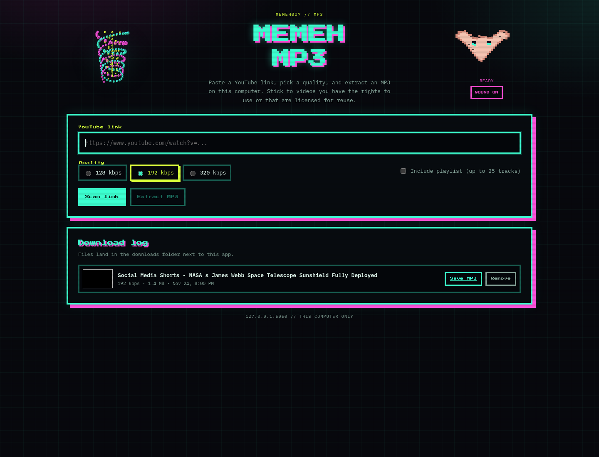

# Memeh MP3

A localhost app that turns a YouTube link into an MP3 on your computer.

Only download content you have the rights to, or that is licensed for reuse.



## Requirements

- Node.js 18 or newer

## Windows

1. Download the ZIP from this repo and unzip it.
2. Double-click `start.bat`.
3. Your browser should open http://127.0.0.1:5050

The first run may take a minute while it installs packages and, if needed, yt-dlp and ffmpeg into the app's bin folder. Admin rights are not required. Leave the window open while you use the app.

## macOS and Linux

```
npm install
node install-tools.js
npm start
```

Then open http://127.0.0.1:5050

If you prefer system packages on macOS, you can install the tools with Homebrew instead of `install-tools.js`:

```
brew install yt-dlp ffmpeg
npm install
npm start
```

## How to use it

1. Paste a YouTube URL.
2. Choose 128, 192, or 320 kbps.
3. Click Scan link to see the title, artwork, and length.
4. Click Extract MP3. Watch the progress bar fill, then save the file.
5. Optional: turn on Include playlist to convert up to 25 tracks from a playlist.

Recent files appear in the download log. They also live in the downloads folder next to this app.

Use SOUND ON in the corner if you want sound effects. The setting is remembered.

## Notes

The server binds only to 127.0.0.1 on port 5050, so it is not exposed to your network.

If port 5050 is already in use, close the other Memeh MP3 window and try again.

If a video is private, age restricted, or region locked, the app will show an error instead of a file.

Press Ctrl+C in the server window to stop it.
